<a href="https://varhex.com">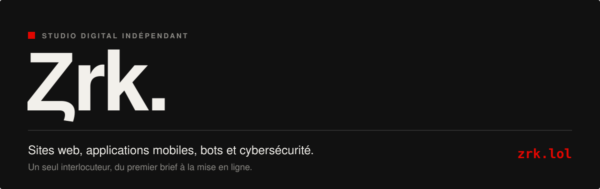</a>

<p align="center">
  <a href="https://varhex.com"></a>
  <a href="https://www.tiktok.com/@vertex.code.zrk"></a>
  <a href="https://discord.gg/4qRhB4c5me"></a>
  <a href="https://wa.me/33787444309"></a>
  <a href="mailto:zrk.pro@varhex.com"></a>
  
</p>

<p align="center">
  <a href="#-à-propos">À propos</a> ·
  <a href="#-contact">Contact</a> ·
  <a href="#-services">Services</a> ·
  <a href="#-offres">Offres</a> ·
  <a href="#-méthode">Méthode</a> ·
  <a href="#-réalisations">Réalisations</a> ·
  <a href="#-projets-open-source">Open source</a> ·
  <a href="#-stack">Stack</a> ·
  <a href="#-faq">FAQ</a>
</p>

<h2 id="-à-propos">&nbsp; À propos</h2>

<table>
<tr>
<td width="56%" valign="top">

Je suis **Ȥrk**, développeur indépendant et fondateur de **[Varhex](https://varhex.com)**, le studio de développement de la Ȥrk Team.

Sites web, applications web et mobiles, bots, API et automatisation : tu expliques ce dont ton activité a besoin, on le conçoit, on le code, on le sécurise et on le met en ligne.

Varhex ne sous-traite pas. Tu parles directement avec la personne qui écrit ton code, du premier appel jusqu'au suivi après la mise en ligne. À la livraison, **le code source est à toi**.

</td>
<td width="44%" valign="top">

```js
const varhex = {
  equipe:   "Ȥrk Team",
  site:     "varhex.com",
  fait:     ["sites", "apps", "bots",
             "API", "automatisation"],
  langues:  ["FR", "EN"],
  securite: "dès le jour 1",
  code:     "100 % sur mesure",
  bientot:  "Varhex Hosting",
};
```

</td>
</tr>
</table>

<h3>&nbsp; En bref</h3>

| | | | |
|:-:|:-:|:-:|:-:|
| **100 %** | **1** | **FR · EN** | **Jour 1** |
| code sur mesure, aucun template | équipe dédiée : la Ȥrk Team | projets dans les deux langues | sécurité intégrée dès le départ |

<h2 id="-contact">&nbsp; Contact</h2>

Un projet, une question ou un devis ? Écris où tu préfères, la Ȥrk Team répond elle-même.

| Canal | Où me trouver | Idéal pour |
|---|---|---|
|  **Site** | [varhex.com](https://varhex.com) | Voir les services, simuler ton projet en 30 s |
|  **WhatsApp** | [+33 7 87 44 43 09](https://wa.me/33787444309) | Demander un devis rapidement |
|  **E-mail** | [zrk.pro@varhex.com](mailto:zrk.pro@varhex.com) | Envoyer un brief détaillé, des fichiers |
|  **Discord** | [discord.gg/4qRhB4c5me](https://discord.gg/4qRhB4c5me) | Échanger, suivre les projets, entraide |
|  **TikTok** | [@vertex.code.zrk](https://www.tiktok.com/@vertex.code.zrk) | Coulisses, tutos, prompts et skills Claude |
|  **GitHub** | [zrk-lol](https://github.com/zrk-lol) | Le code open source et les templates |
|  **Instagram** | bientôt | — |

<h2 id="-services">&nbsp; Services</h2>

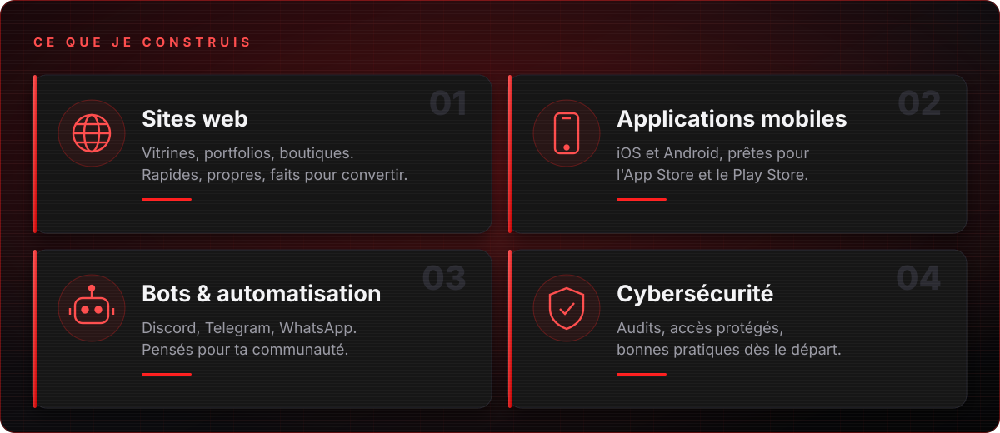

Douze services, une seule équipe qui porte ton projet du premier appel au dernier commit. Chaque devis est fait sur mesure.

### 01 · Construire

| # | Service | Ce que c'est | Inclus |
|:-:|---|---|---|
| 01 | **Sites & landing pages** | Vitrines, portfolios et landing pages qui chargent vite, se référencent bien et convertissent | Design sur mesure · Responsive · SEO de base |
| 02 | **Apps web & SaaS** | Tableaux de bord, espaces clients, SaaS et MVP avec comptes, rôles et données | Comptes · Panel admin · Base de données |
| 03 | **Applications mobiles** | Apps iOS et Android livrées prêtes à publier sur l'App Store et le Play Store | iOS & Android · Publication · Notifications |
| 04 | **E-commerce** | Boutiques avec catalogue, panier, paiement sécurisé et gestion des commandes | Paiements · Catalogue · Commandes |

### 02 · Automatiser

| # | Service | Ce que c'est | Inclus |
|:-:|---|---|---|
| 05 | **Bots Discord, Telegram & WhatsApp** | Modération, tickets, rôles, mini-jeux, notifications : des bots pensés pour ta communauté | Slash commands · Dashboard · 24/7 |
| 06 | **IA & chatbots** | Assistants IA qui répondent à tes visiteurs à partir de ton contenu | Assistant IA · Tes infos · Garde-fous |
| 07 | **API & back-end** | API REST, fonctions serveur, webhooks et intégrations entre tes outils | API · Webhooks · Documentation |
| 08 | **Automatisation & scripts** | Imports, rapports, synchronisation entre apps : fini les tâches répétitives | Workflows · Tâches planifiées · Rapports |

### 03 · Sécuriser & maintenir

| # | Service | Ce que c'est | Inclus |
|:-:|---|---|---|
| 09 | **Audit de sécurité** | Revue des accès, des données, des dépendances et de l'hébergement, avec un plan d'action clair | Rapport · Corrections · Bonnes pratiques |
| 10 | **Refonte & performance** | Nouveau design, chargement plus rapide, meilleure accessibilité et meilleur SEO | Refonte · Vitesse · Accessibilité |
| 11 | **Maintenance & monitoring** | Mises à jour, sauvegardes, corrections de bugs et surveillance automatique | Mises à jour · Monitoring · Correctifs |
| 12 | **Déploiement & DevOps** | Hébergement, domaines, CI/CD et tests automatiques pour des mises en ligne sans stress | CI/CD · Hébergement · Domaines |

<h2 id="-offres">&nbsp; Offres</h2>

Chaque projet est chiffré après un premier échange. Pas de frais cachés : tu sais exactement ce que tu paies avant que quoi que ce soit commence.

| | **Launch** | **Business** · le plus demandé | **Custom** |
|---|---|---|---|
| **Pour qui** | Démarrer vite | Projets qui grandissent | Produits ambitieux |
| **Exemples** | Site vitrine, landing page, bot Discord/Telegram simple | Site complet, app web, app mobile, e-commerce | SaaS, plateforme, MVP |
| **Ce qui est compris** | Design sur mesure, responsive, mise en ligne sur ton domaine | Panel admin, comptes, revue de sécurité incluse | IA, API, automatisation, roadmap dédiée, maintenance et monitoring |
| **Prix** | Sur devis | Sur devis | Sur devis |
| | [Demander un devis →](https://wa.me/33787444309) | [Demander un devis →](https://wa.me/33787444309) | [En parler →](mailto:zrk.pro@varhex.com) |

> Tu ne sais pas quelle offre choisir ? Le **simulateur de projet** sur [varhex.com](https://varhex.com) construit ton brief en 30 secondes et te recommande une offre.

<h2 id="-méthode">&nbsp; Méthode</h2>

| Étape | Ce qui se passe | Ce que tu reçois |
|:-:|---|---|
| **01 · Appel & brief** | On parle de ton idée, de tes objectifs et de ton budget, puis on définit le périmètre ensemble | Un périmètre clair |
| **02 · Devis & plan** | Je chiffre et je planifie ce qui sera construit, étape par étape | Un devis détaillé et un planning |
| **03 · Design & code** | La Ȥrk Team conçoit et code le projet, avec des points réguliers et des démos | Des démos au fil de l'eau |
| **04 · Mise en ligne & suivi** | Tests, déploiement sécurisé, puis suivi et maintenance si tu le souhaites | Le projet en ligne, testé, documenté, et son code source |

<h2 id="-réalisations">&nbsp; Réalisations</h2>

Pas de maquettes : du code qui tourne en production aujourd'hui.

| Projet | Type | Ce qu'il fait | Stack |
|---|---|---|---|
| **Site Varhex + assistant IA** | Site · IA | Site bilingue avec un robot guide qui répond aux visiteurs via l'API Groq. Il ne dit que ce que dit le site, n'invente ni prix ni délai, et la clé reste côté serveur | React · TypeScript · TanStack Start · Groq |
| **Gardien de code autonome** | Automatisation · IA | Un agent qui vérifie le site toutes les 5 minutes, propose de petits correctifs relus par une seconde IA, lance typage, build et tests, puis déploie | GitHub Actions · Node.js · CI/CD |
| **Qualité à chaque mise en ligne** | Qualité | Vérification des types, tests automatiques et build de production avant chaque changement. La même discipline s'applique aux projets clients | TypeScript · Bun test · Vite |

<h2 id="-projets-open-source">&nbsp; Projets open source</h2>

Des bases propres et testées, prêtes à cloner, par **Varhex by Ȥrk Team**.

<table>
<tr>
<td width="50%"><a href="https://github.com/zrk-lol/discord-bot-template">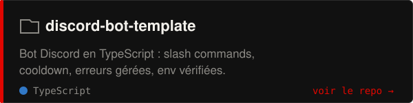</a></td>
<td width="50%"><a href="https://github.com/zrk-lol/telegram-bot-template">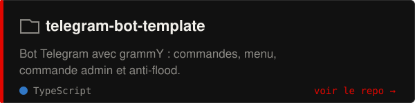</a></td>
</tr>
<tr>
<td><a href="https://github.com/zrk-lol/api-template">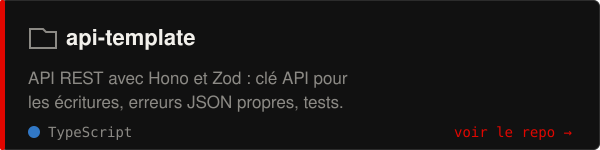</a></td>
<td><a href="https://github.com/zrk-lol/ai-assistant-template">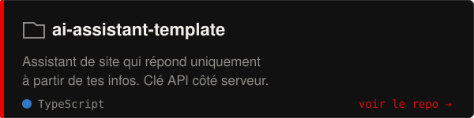</a></td>
</tr>
<tr>
<td><a href="https://github.com/zrk-lol/automation-template">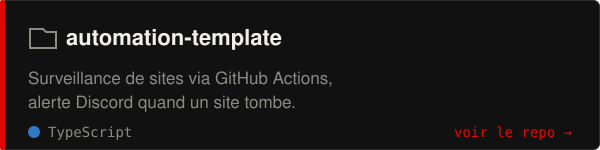</a></td>
<td><a href="https://github.com/zrk-lol/claude-skills-anti-ia">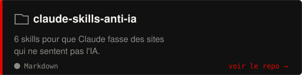</a></td>
</tr>
</table>

| Repo | À utiliser pour | Démarrer |
|---|---|---|
| [discord-bot-template](https://github.com/zrk-lol/discord-bot-template) | Un bot Discord avec slash commands, cooldown et erreurs gérées | `npm install` puis `npm run dev` |
| [telegram-bot-template](https://github.com/zrk-lol/telegram-bot-template) | Un bot Telegram avec menu, commande admin et anti-flood (grammY) | `npm install` puis `npm run dev` |
| [api-template](https://github.com/zrk-lol/api-template) | Une API REST Hono + Zod, protégée par clé API, avec tests | `npm install` puis `npm run dev` |
| [ai-assistant-template](https://github.com/zrk-lol/ai-assistant-template) | Le back-end d'un assistant de site qui ne répond qu'avec tes infos | `npm install` puis `npm run dev` |
| [automation-template](https://github.com/zrk-lol/automation-template) | Surveiller tes sites avec GitHub Actions et une alerte Discord | `npm install` puis `npm run dev` |
| [claude-skills-anti-ia](https://github.com/zrk-lol/claude-skills-anti-ia) | 6 skills pour que Claude fasse des sites qui ne sentent pas l'IA | `/plugin marketplace add zrk-lol/claude-skills-anti-ia` |

<h2 id="-pack-vidéo">&nbsp; 20 prompts vidéo pour Claude</h2>

Un prompt à copier dans Claude Code, des crochets à remplir, et une vidéo MP4 sur mesure en sortie.

<p align="center">
<a href="video-prompts/README.md#01--intro-logo-néon">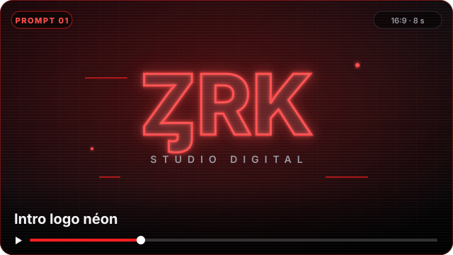</a>
<a href="video-prompts/README.md#02--promo-de-site-web">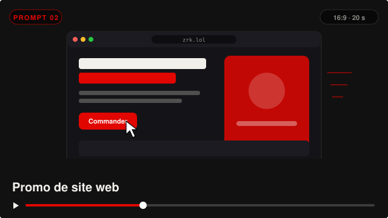</a>
<a href="video-prompts/README.md#03--démo-dapp-mobile">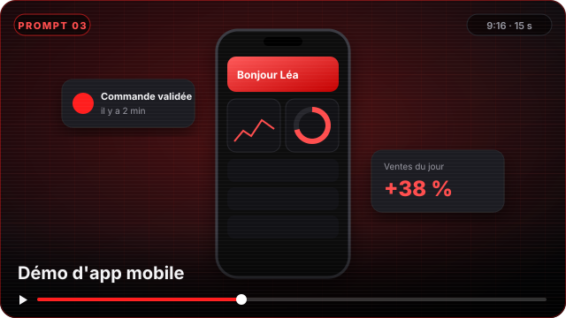</a>
<a href="video-prompts/README.md#04--bot-discord-en-action">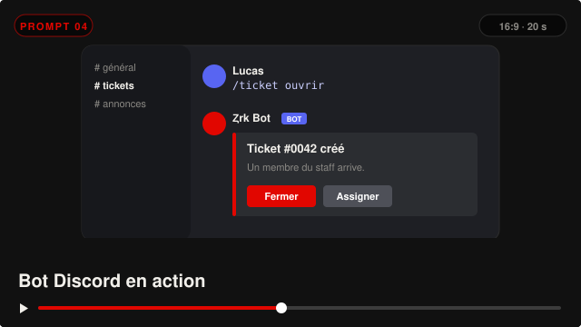</a>
<a href="video-prompts/README.md#05--glitch-cybersécurité">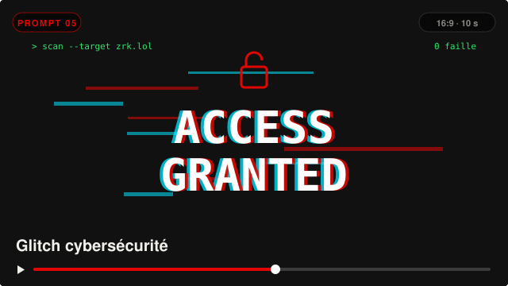</a>
<a href="video-prompts/README.md#06--typographie-cinétique">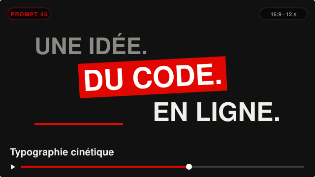</a>
<a href="video-prompts/README.md#07--promo-halloween-10-">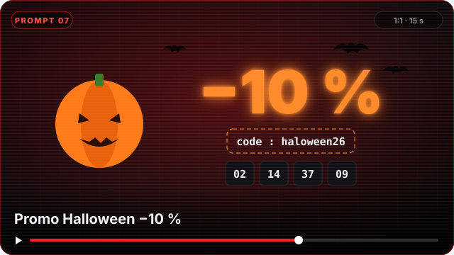</a>
<a href="video-prompts/README.md#08--avis-client-animé">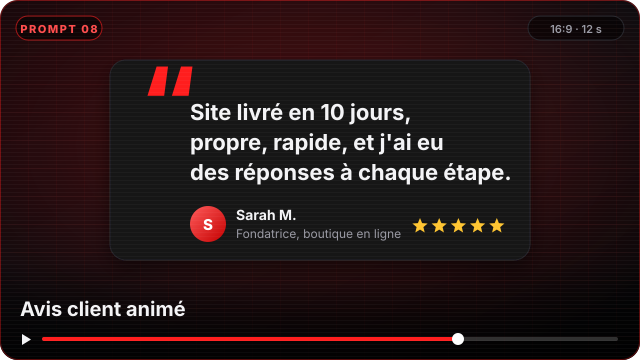</a>
</p>

| Catégorie | Prompts |
|---|---|
| Intros & marque | Intro logo néon · Logo en particules · Intro YouTube · Outro Discord |
| Promo | Promo de site web · Promo Halloween · Offres et tarifs · Avant / Après |
| Démo produit | App mobile · Bot Discord · Lancement d'un hébergement · Tuto terminal |
| Réseaux sociaux | Story Instagram · Face caméra sous-titré · Typographie cinétique |
| Confiance | Avis client · Chiffres clés · Méthode en 3 étapes · Portfolio 3D · Glitch cybersécurité |

<p align="center"><a href="video-prompts/README.md"><b>Voir les 20 prompts →</b></a></p>

<h2 id="-skills-claude">&nbsp; Skills Claude anti-IA</h2>

| Skill | Rôle |
|---|---|
| `textes-humains` | Des textes concrets, avec des faits, sans les tournures typiques de l'IA |
| `design-pas-ia` | Pas de dégradés violets ni de cartes à icônes génériques |
| `microcopy` | Boutons, formulaires et erreurs qui disent ce qui se passe |
| `typo-francaise` | Espaces insécables, guillemets, majuscules accentuées |
| `voix-de-marque` | Un guide `VOIX.md` tiré de tes vrais messages |
| `audit-site-ia` | Une note sur 30 et les 5 corrections prioritaires |

→ **[claude-skills-anti-ia](https://github.com/zrk-lol/claude-skills-anti-ia)**

<h2>&nbsp; Varhex Hosting</h2>

<a href="https://varhex.com/hosting">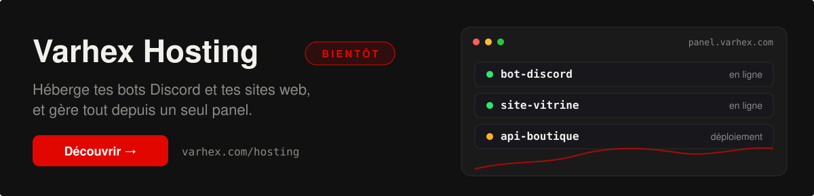</a>

<h2 id="-stack">&nbsp; Stack</h2>

<p>
<br/>
<br/>

</p>

| Domaine | Outils |
|---|---|
| Web | React, TypeScript, TanStack, Vite, Tailwind CSS |
| Mobile | Apps iOS et Android de qualité native |
| Bots & back-end | Node.js, Discord API, Telegram API, WhatsApp, REST |
| IA | Groq, API compatibles OpenAI, assistants avec garde-fous |
| DevOps | GitHub Actions, Cloudflare, Vercel, CI/CD, tests automatiques |
| Données | PostgreSQL, MongoDB, Supabase |

<h2 id="-faq">&nbsp; FAQ</h2>

<details>
<summary><b>Combien coûte un projet ?</b></summary>
<br/>
Tout est sur devis, après un premier échange. Le devis dit exactement ce qui sera livré et dans quel ordre, sans frais cachés. Le simulateur sur <a href="https://varhex.com">varhex.com</a> donne une première idée en 30 secondes.
</details>

<details>
<summary><b>À qui appartient le code ?</b></summary>
<br/>
À toi. À la livraison, tu reçois le code source, testé et documenté.
</details>

<details>
<summary><b>Vous utilisez des templates ?</b></summary>
<br/>
Non. Chaque projet est codé sur mesure. Les templates open source de ce profil sont des points de départ pour les développeurs, pas ce qui est livré aux clients.
</details>

<details>
<summary><b>Et après la mise en ligne ?</b></summary>
<br/>
La Ȥrk Team reste ton contact : maintenance, mises à jour, monitoring et nouvelles fonctionnalités si tu le souhaites.
</details>

<details>
<summary><b>Vous travaillez en anglais ?</b></summary>
<br/>
Oui, en français et en anglais, et les projets peuvent être livrés dans les deux langues.
</details>

<details>
<summary><b>Comment démarrer ?</b></summary>
<br/>
Écris sur <a href="https://wa.me/33787444309">WhatsApp</a>, par <a href="mailto:zrk.pro@varhex.com">e-mail</a> ou sur <a href="https://discord.gg/4qRhB4c5me">Discord</a> avec ton idée en quelques lignes. On cale un appel et tu reçois un devis.
</details>

<a href="https://varhex.com"></a>

<p align="center">
<a href="https://varhex.com"></a>
<a href="https://www.tiktok.com/@vertex.code.zrk"></a>
<a href="https://discord.gg/4qRhB4c5me"></a>
<a href="https://wa.me/33787444309"></a>
<a href="mailto:zrk.pro@varhex.com"></a>

</p>

<p align="center"><sub>© 2026 Varhex by Ȥrk Team · Conçu, codé et livré par la Ȥrk Team</sub></p>
