<a href="https://zrk.lol"></a>

<div align="center">

<a href="https://zrk.lol"></a>

<a href="https://zrk.lol"></a>
<a href="https://discord.gg/4qRhB4c5me"></a>
<a href="mailto:zrk.pro.dev@gmail.com"></a>


</div>


## 👋 Salut, moi c'est Ȥrk

<table>
<tr>
<td width="55%" valign="top">

Je suis développeur indépendant et j'ai monté **[Ȥrk.](https://zrk.lol)**, mon studio.

Tu m'expliques ton idée, je la transforme en site, en app ou en bot. Je fais le design, le code, la mise en ligne et le suivi. Tu parles avec moi du début à la fin, pas avec un commercial.

Je viens de la cybersécurité. Concrètement : les accès, les données et l'hébergement sont pensés dès le premier jour, pas rajoutés à la fin.

🎃 **En ce moment :** −10 % sur tout avec le code `haloween26`

</td>
<td width="45%" valign="top">

```js
const zrk = {
  studio:  "Ȥrk.",
  site:    "zrk.lol",
  fait:    ["sites", "apps", "bots"],
  bonus:   "cybersécurité",
  contact: "direct, sans intermédiaire",
  bientot: "Ȥrk. Hosting",
};
```

</td>
</tr>
</table>


<a href="https://zrk.lol/hosting"></a>


## 🎬 Pack gratuit : 20 prompts vidéo pour Claude

Tu copies un prompt, tu changes ce qui est entre crochets, tu le colles dans **Claude Code**, et tu récupères une vidéo MP4 faite pour toi (intro, promo, démo de bot, story…).

<div align="center">

<a href="video-prompts/README.md#01--intro-logo-néon"></a>
<a href="video-prompts/README.md#02--promo-de-site-web"></a>
<a href="video-prompts/README.md#03--démo-dapp-mobile"></a>
<a href="video-prompts/README.md#04--bot-discord-en-action"></a>
<a href="video-prompts/README.md#05--glitch-cybersécurité"></a>
<a href="video-prompts/README.md#06--typographie-cinétique"></a>
<a href="video-prompts/README.md#07--promo-halloween-10-"></a>
<a href="video-prompts/README.md#08--avis-client-animé"></a>
<a href="video-prompts/README.md#09--chiffres-clés-animés">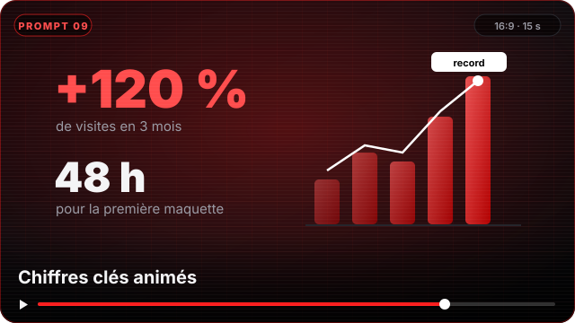</a>
<a href="video-prompts/README.md#10--avant--après">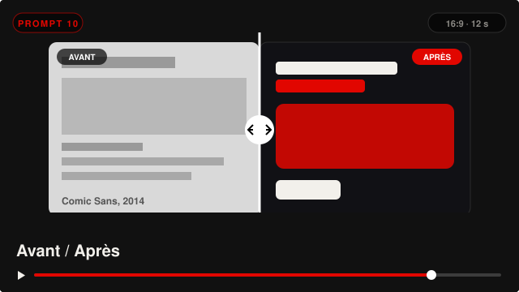</a>
<a href="video-prompts/README.md#11--story-instagram">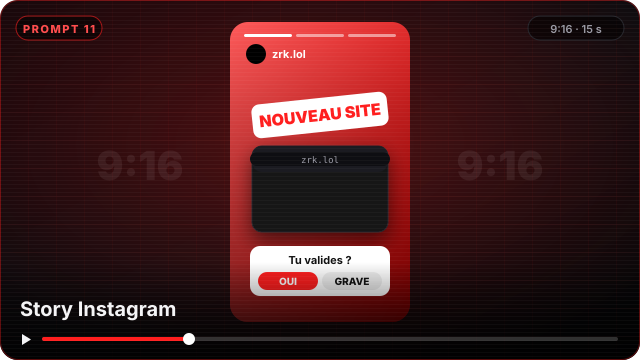</a>
<a href="video-prompts/README.md#12--intro-de-chaîne-youtube">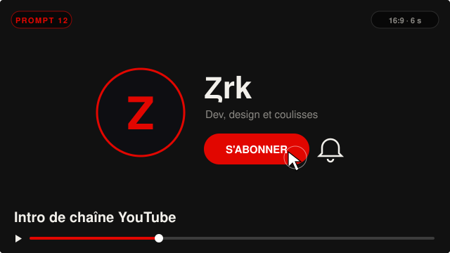</a>
<a href="video-prompts/README.md#13--tuto-code-en-terminal">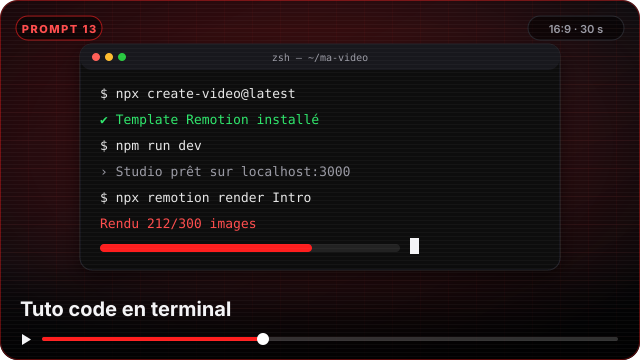</a>
<a href="video-prompts/README.md#14--lancement-dun-hébergement">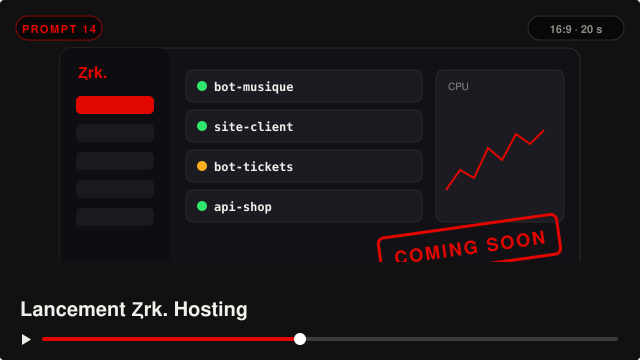</a>
<a href="video-prompts/README.md#15--méthode-en-3-étapes">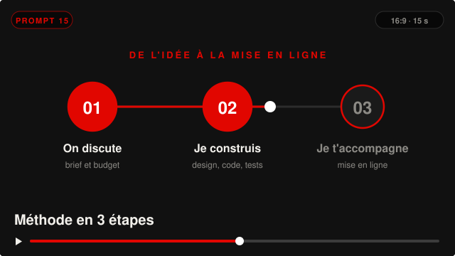</a>
<a href="video-prompts/README.md#16--showcase-portfolio-3d">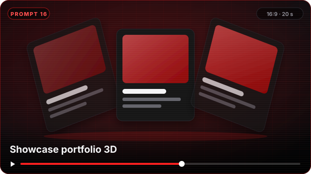</a>
<a href="video-prompts/README.md#17--logo-en-particules">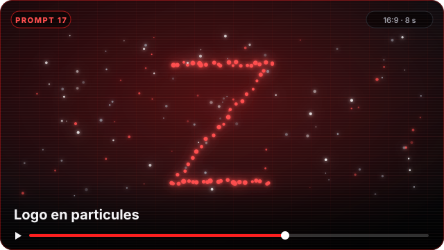</a>
<a href="video-prompts/README.md#18--offres-et-tarifs">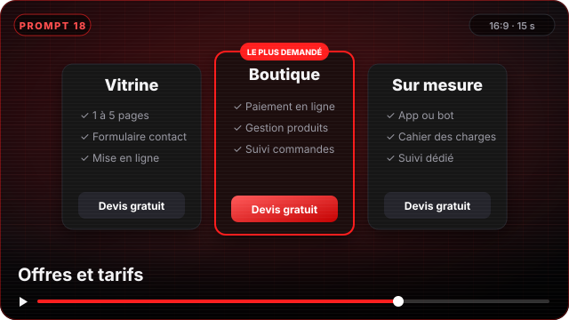</a>
<a href="video-prompts/README.md#19--face-caméra-sous-titré">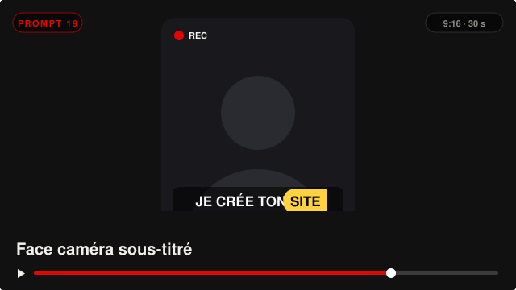</a>
<a href="video-prompts/README.md#20--outro--rejoins-le-discord">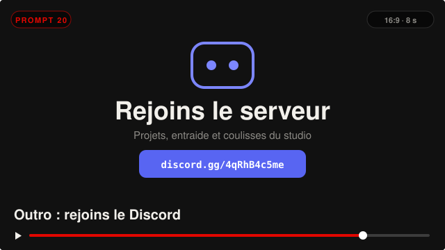</a>

<a href="video-prompts/README.md"></a>

</div>


## 🧠 Skills Claude : des sites qui ne sentent pas l'IA

Tu as déjà vu ces sites où tout le monde « libère son potentiel » avec un dégradé violet ? J'ai écrit **6 skills pour Claude** qui l'empêchent de faire ça : textes plus humains, design moins générique, typo française correcte, et un audit pour repérer ce qui fait « généré par IA ».

<div align="center">

<a href="https://github.com/zrk-lol/claude-skills-anti-ia"></a>

</div>


## 🧰 Ce que j'utilise

<div align="center">

<br/>


</div>


<a href="https://discord.gg/4qRhB4c5me"></a>

<div align="center">

<a href="https://zrk.lol"></a>
<a href="https://discord.gg/4qRhB4c5me"></a>


</div>
